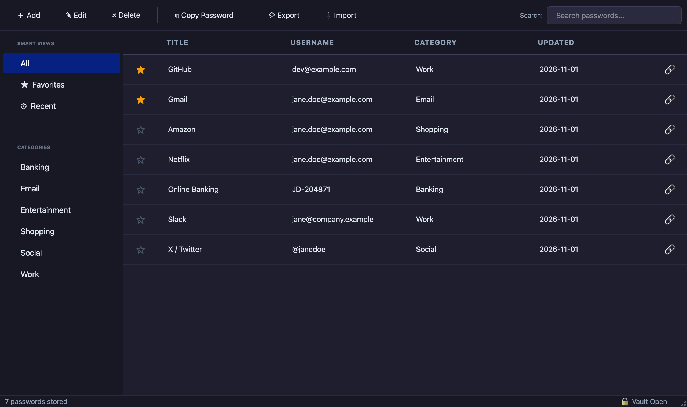

<h1 align="center">
  <br/>
  VaultMind
</h1>

<p align="center">
  A secure, fully offline password manager for Windows and macOS — built with Python and PyQt5.
</p>

<p align="center">
  <a href="https://github.com/DevVettel/VaultMind/actions/workflows/ci.yml"></a>
  <a href="https://github.com/DevVettel/VaultMind/releases/latest"></a>
  
  
  
  
  
</p>

<p align="center">
  
</p>

---

## Overview

VaultMind stores and encrypts all your credentials locally on your machine. No cloud, no sync, no accounts — your data never leaves your device. Every password is encrypted with a key derived from your master password, which is never stored anywhere.

---

## Features

| | |
|---|---|
| **Master Password Vault** | Key derived via PBKDF2HMAC-SHA256 (480,000 iterations). Master password is never stored. |
| **Authenticated Encryption** | Every credential is encrypted at rest using `cryptography.Fernet` (AES-128-CBC + HMAC-SHA256). |
| **Encrypted Backups** | Export the whole vault to a single `.vmbackup` file protected by its own password; import it into any VaultMind vault. |
| **Password Generator** | Cryptographically secure (`secrets`), configurable length (8–64 chars), uppercase, lowercase, digits, and symbols with live preview. |
| **Strength Meter** | Real-time color-coded Weak / Medium / Strong indicator on every password field. |
| **Category Filtering** | Sidebar filters by General, Email, Social, Banking, Work, Shopping, and more. |
| **Clipboard Auto-clear** | Copied passwords are automatically wiped from the clipboard after 30 seconds. |
| **Auto-lock** | After 5 minutes of inactivity the vault locks, the key is wiped from memory and the master password is required to continue. |
| **Dark Theme** | Clean dark UI with native Windows title bar integration. |

---

## Download

Prebuilt apps for macOS and Windows are attached to every [release](https://github.com/DevVettel/VaultMind/releases/latest) — no Python required.

> The builds are not code-signed. On macOS, right-click the app → **Open** the first time; on Windows, choose **More info → Run anyway** in SmartScreen.

---

## Run from Source

**Windows**

```bash
# 1. Clone the repository
git clone https://github.com/DevVettel/VaultMind.git
cd VaultMind

# 2. Create a virtual environment
python -m venv venv
venv\Scripts\activate

# 3. Install dependencies
pip install -r requirements.txt

# 4. Run
python password_manager/main.py
```

**macOS**

```bash
# 1. Clone the repository
git clone https://github.com/DevVettel/VaultMind.git
cd VaultMind

# 2. Create a virtual environment
python3 -m venv venv
source venv/bin/activate

# 3. Install dependencies
pip install -r requirements.txt

# 4. Run
python password_manager/main.py
```

**Requirements:** Python 3.9+, Windows 10/11 or macOS 11+ (Apple Silicon & Intel)

> On macOS the vault is stored at `~/Library/Application Support/VaultMind/vaultmind.db`
> (on Windows: `%APPDATA%\VaultMind\vaultmind.db`) instead of inside the project folder.

---

## Security

See [SECURITY.md](SECURITY.md) for the threat model and how to report a vulnerability.

| Concern | Implementation |
|---|---|
| Master password | Never stored. Verified by decrypting a known token with the PBKDF2-derived key, so every guess costs the full 480,000 iterations |
| Key derivation | PBKDF2HMAC-SHA256, 480,000 iterations, 16-byte random salt |
| Credential encryption | `cryptography.Fernet` — AES-128-CBC + HMAC-SHA256 integrity check |
| Database | `vaultmind.db` is local-only and excluded from version control |
| Backups | Own random salt and PBKDF2 key per file; contents are a single Fernet token |
| Clipboard | Auto-cleared 30 seconds after copy, on lock and on exit (only if it still holds the copied password) |
| Inactivity | Vault locks after 5 minutes of no input anywhere in the app; the encryption key is discarded until unlocked |

---

## Project Structure

```
VaultMind/
├── password_manager/
│   ├── main.py                         # Entry point
│   ├── resources.py                    # Asset lookup (source checkout & packaged app)
│   ├── version.py                      # Single source of the app version
│   ├── core/
│   │   ├── database.py                 # SQLite CRUD operations
│   │   ├── encryption.py               # Key derivation, verifier & Fernet encrypt/decrypt
│   │   ├── vault.py                    # Master password setup / unlock
│   │   ├── backup.py                   # Encrypted export / import
│   │   └── password_generator.py       # Password generation & strength scoring
│   └── ui/
│       ├── main_window.py              # Main window — table, sidebar, toolbar
│       ├── add_password_dialog.py      # Add / Edit dialog with inline generator
│       ├── master_password_dialog.py   # First-launch setup & unlock screen
│       └── utils.py                    # Windows dark title bar helper
├── tests/                              # pytest suite (core + headless UI)
├── .github/                            # CI, release builds, issue/PR templates
├── assets/                             # Shipped with the app
│   ├── icons/                          # App icon PNGs, 16–1024 px
│   ├── ui/                             # Stylesheet images
│   ├── icon.icns                       # macOS bundle icon
│   ├── icon.ico                        # Windows executable icon
│   └── icon-source.jpeg                # Icon source artwork (2048×2048)
├── docs/
│   └── screenshots/                    # README images
├── pyproject.toml                      # Project metadata, ruff & pytest config
├── requirements.txt
└── requirements-dev.txt
```

---

## Dependencies

```
PyQt5 >= 5.15
cryptography >= 41.0
pyperclip >= 1.8
```

---

## Development

```bash
pip install -r requirements-dev.txt
python -m pytest        # run the test suite
ruff check .            # lint
```

Tests use a temporary database and never touch your real vault. UI tests run headless (`QT_QPA_PLATFORM=offscreen`).

Contributions are welcome — see [CONTRIBUTING.md](CONTRIBUTING.md). Release notes live in [CHANGELOG.md](CHANGELOG.md).

---

## License

This project is licensed under the [MIT License](LICENSE).
